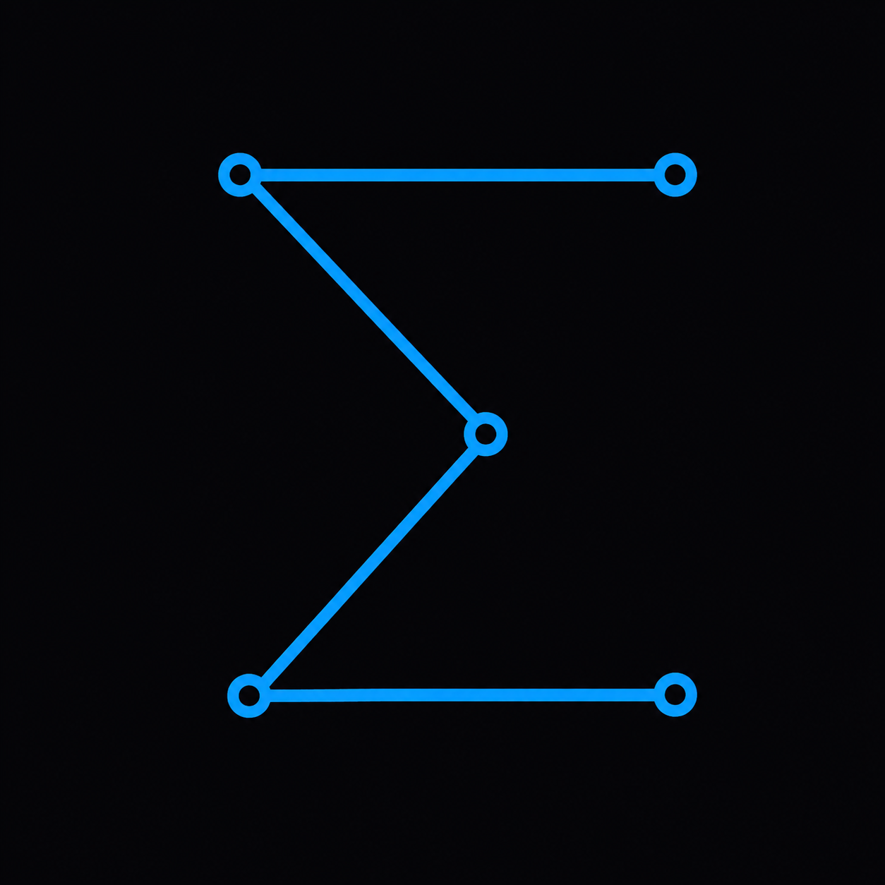

<p align="center"></p>

# Espilon Learn content-authoring kit

Français: [README.fr.md](README.fr.md)

This repository is the canonical set of templates and documentation for
contributing content to Espilon Learn, the cybersecurity learning platform at
[learn.espilon.net](https://learn.espilon.net). It is run by Espilon, a
not-for-profit association.

If you want to build a lab, a challenge, a course or a wiki page and ship it to
the platform, this is where you start. Copy a template, fill it in, run the local
checks, and submit it through the Espilon Learn member portal. You do not deploy
anything yourself; the maintainers ingest and publish accepted submissions.

## What you can build

| You are building | Copy this template | Follow this doc |
|---|---|---|
| A static challenge | `templates/static-challenge/` | `docs/static-challenge.md` |
| A Model-B lab | `templates/model-b-lab/` | `docs/model-b-lab.md` |
| A course | `templates/course/` | `docs/course.md` |
| A wiki entry | `templates/wiki/` | `docs/wiki-entry.md` |

Every template is a real, working example, not a sketch. The static-challenge
template passes the shipped validators as-is, and each doc tells you exactly
which checks you can run locally and which the maintainers run at ingestion.

- A **static challenge** is a self-contained puzzle: downloadable files and a
  flag the player recovers from them alone. No server.
- A **Model-B lab** is a live per-session target the player attacks from their
  own machine. The lab ships only the target; the flag travels over the
  protocol.
- A **course** is a bilingual sequence of lessons that teaches a subject and ends
  by applying it to a challenge or a lab.
- A **wiki entry** is a bilingual reference page about one thing: a chip, a
  protocol, a bus, a concept.

## Usage flow

1. Copy the template for your content type into a working folder.
2. Fill it in, following the matching doc under `docs/`.
3. Run the local checks (see `validators/README.md` and the per-type doc).
4. Submit through the Espilon Learn member portal.

## Run the local checks

```bash
pip install pyyaml

# Static challenge: build the artifact, prove it solves, validate, scan FR.
python3 -I templates/static-challenge/generate.py
python3 -I templates/static-challenge/solve.py
python3 -I validators/validate_static_meta.py templates/static-challenge
python3 -I validators/check_fr_accents.py templates/static-challenge

# Model-B lab: field and compose check.
python3 -I validators/check_lab_yaml.py templates/model-b-lab
```

Point the validators at your own folder instead of the template. Courses and
wiki entries carry checks that need the platform or the full content corpus;
those run on the maintainer side at ingestion, and each per-type doc says exactly
which checks you run locally and which are maintainer-side.

## House rules

Content is bilingual (English and French), carries real French accents, and uses
no emoji and no em dash or en dash anywhere. See `CONTRIBUTING.md` for the full
rules and how to propose content.

## License

MIT. See `LICENSE`.

The Espilon name and logo are trademarks of the Espilon association and are not
covered by the MIT license. The MIT license applies to the templates, scripts
and documentation in this repository, not to the Espilon marks.
